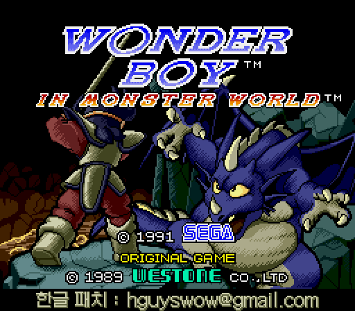
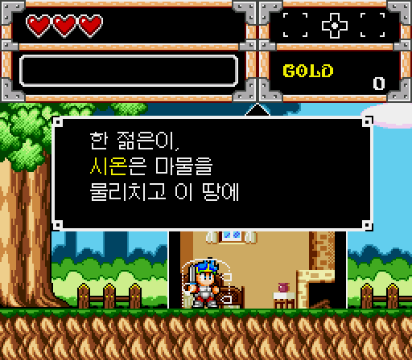
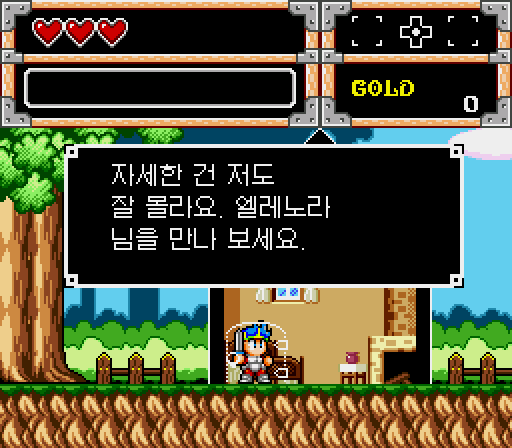
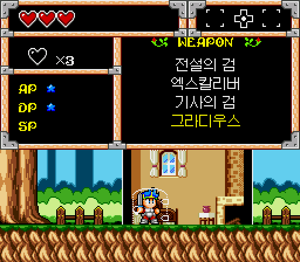
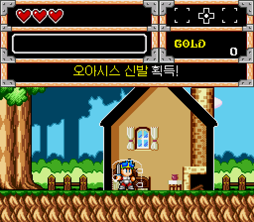
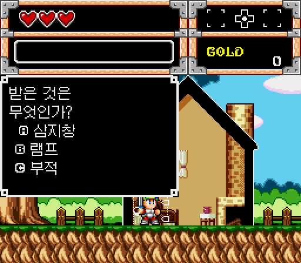

# 원더보이 인 몬스터월드 (메가드라이브) 한글 패치

메가드라이브 **Wonder Boy in Monster World** (북미·유럽판)의 한글 패치입니다.
일본판 제목은 *ワンダーボーイV モンスターワールドIII*(원더보이 V 몬스터월드 III, 1991)입니다.

> 🧪 **베타 버전입니다.** 모든 대사는 자동 검사로 확인했지만 처음부터 끝까지 사람이 직접 플레이한 검수는 진행 중입니다. 이상한 곳을 발견하시면 제보 부탁드립니다.

> 이 저장소에는 **IPS 패치 파일만** 있습니다. 게임 ROM은 포함하지 않으며 배포하지 않습니다.
> 원본 ROM은 직접 준비해 주세요.

## 스크린샷

| | |
|---|---|
|  |  |
| 타이틀 화면 | 오프닝 이야기 |
|  |  |
| 마을 사람과의 대화 | 상태창 장비 이름 |
|  |  |
| 아이템 획득 메시지 | 스핑크스의 퀴즈 |

## 적용 방법

1. 원본 ROM을 준비합니다. 아래 확인값과 같아야 합니다.

   | 항목 | 값 |
   |---|---|
   | 파일 | Wonder Boy in Monster World (USA, Europe).md (또는 .bin/.gen) |
   | 크기 | 1,048,576 바이트 (1MB) |
   | CRC32 | `0D901482` |
   | SHA1 | `772C3C71973762EAC46E6C180A036C1F3BBD937A` |

2. [Lunar IPS](https://www.romhacking.net/utilities/240/) 같은 IPS 패치 도구로
   `wonderboy-monsterworld-md-kr.ips` 를 원본 ROM에 적용합니다.
3. 패치된 ROM(1MB)을 에뮬레이터(Genesis Plus GX(RetroArch), BlastEm, MAME 등)로 실행합니다.
   ⚠ Kega Fusion 은 현재 타이틀 화면에서 START 후 멈춥니다 (세이브 메모리 인식 문제, 해결 예정).

   | 패치 후 | 값 |
   |---|---|
   | 크기 | 1,048,576 바이트 (1MB) |
   | CRC32 | `59336D49` |
   | SHA1 | `111BFAC8A444815D6802BF69579678AB0E71EA0C` |

## 한글화 내용

- 모든 대사 131개 (마을 사람, 상점·여관, 여왕·장로, 스핑크스 퀴즈, 보스 등장, 엔딩)
- 무기·방어구·방패·신발·아이템 이름, 지명·인물 이름 (상태창·상점 목록 포함)
- 아이템·골드 획득 메시지, 퀴즈 결과, 예/아니오 선택지
- 대사창 한글은 12px 글꼴로 한 줄에 약 13자, 원작과 같은 스크롤 방식·강조색(이름은 노란 글씨)
- 메뉴 탭(WEAPON·ARMOR 등)과 능력치(AP·DP·SP·GOLD), 마법 메뉴 이름은 칸이 좁아 영문 그대로입니다.

## 변경 내역

- **2026-10-10** 베타 3
  - 버섯 숲(Area 2) 등 필드에서 대화창이 닫힌 후 배경 덩굴/나무 타일이 깨지던 문제 수정
  - 특정 필드 및 상점 화면에서 대화창 타일과 배경 타일 간의 VRAM 충돌 방지
- **2026-10-10** 베타 2
  - ROM 크기를 원본과 같은 1MB로 유지
  - 뱀·상점 주인·보스 등 일부 캐릭터 그림이 깨지던 문제 수정
  - 아이템·골드 획득 메시지 글자 깨짐 수정
  - 오카리나 연습 장면이 끝나지 않고 반복되던 문제 수정
- **2026-10-10** 첫 공개 (베타)

## 크레딧

- 한글화: hguyswow@gmail.com
- 한글 서체: [갈무리11(Galmuri11)](https://github.com/quiple/galmuri) — SIL Open Font License

## 후원 ☕

이 한글 패치는 무료로 배포됩니다. 재미있게 즐기셨다면 커피 한 잔 값이라도 후원해 주세요.
보내주신 후원은 더 좋은 게임 한글화와 프로그램을 만들어 배포하는 데 큰 힘이 됩니다. 감사합니다!

- 국민은행 `027210862460` (예금주: 강*호)
- PayPal: `hguyswow`

---

이 패치는 비공식 팬 번역이며 세가 및 원 저작권자와 관련이 없습니다.
